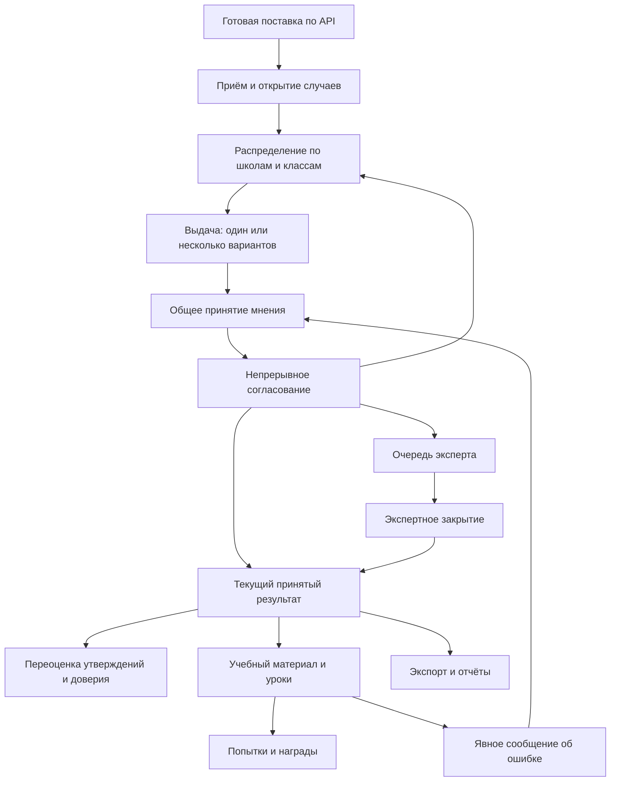
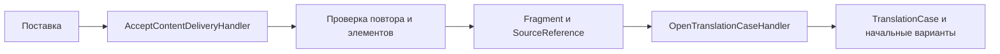
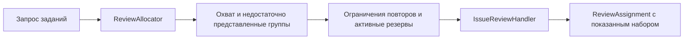
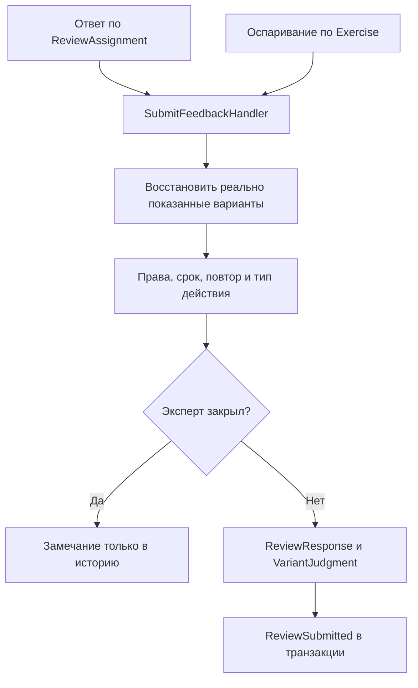
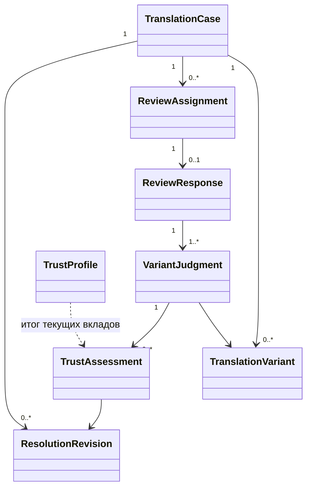
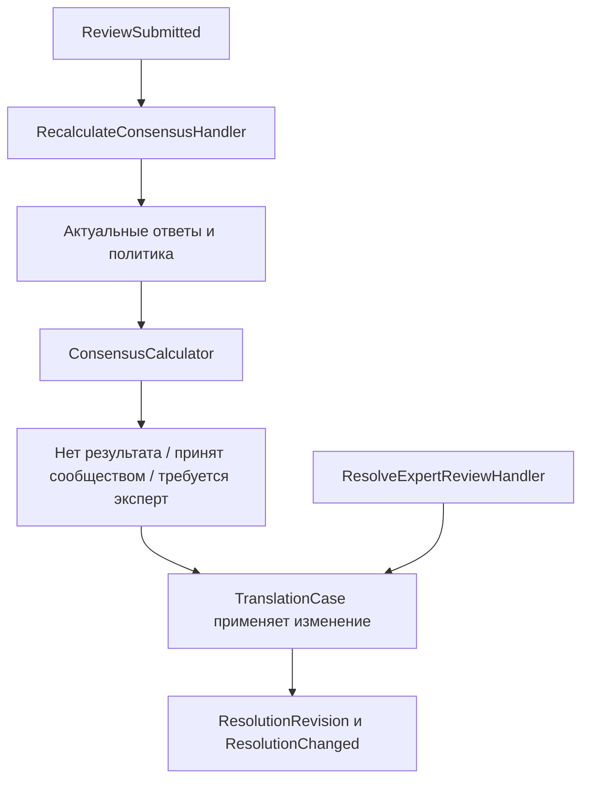
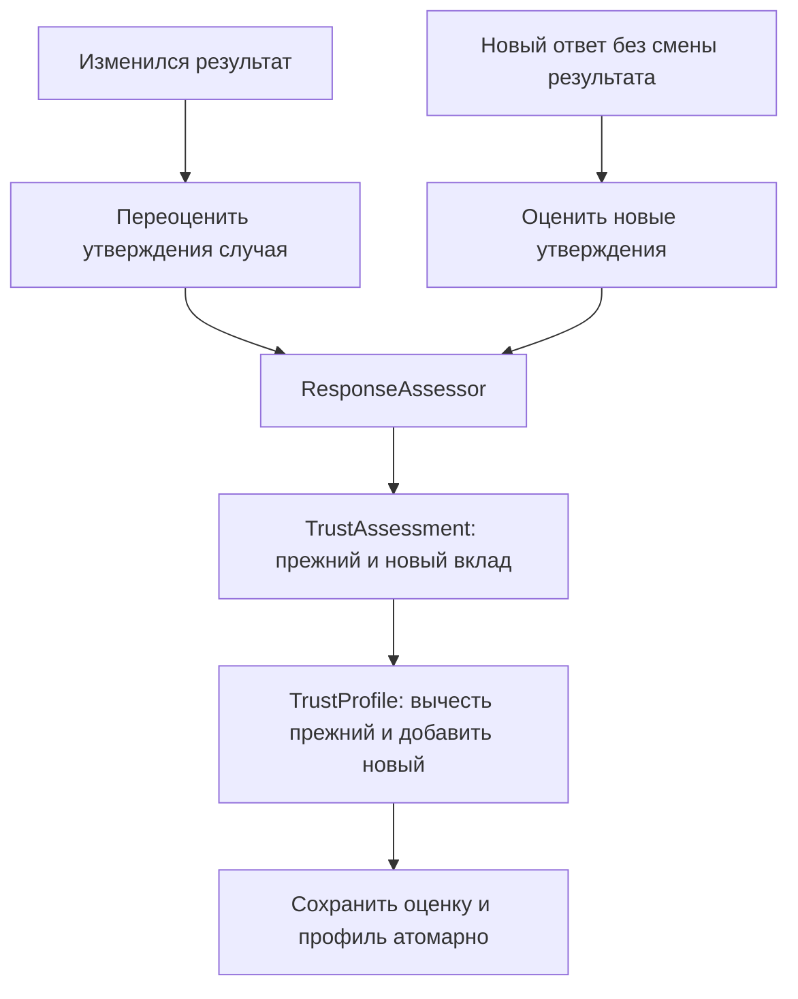
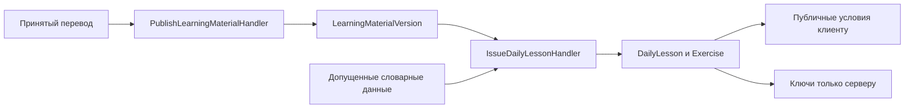
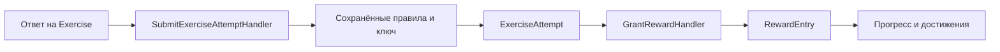

# Фичи и будущие C#-классы

Актуальная последовательность реализации — [START-HERE.md](START-HERE.md). Первое проверочное представление содержит один перевод; способность модели хранить набор не требует сейчас реализовывать множественный выбор.

Основание: [DOMAIN.md](DOMAIN.md). Схемы — проектирование; готового приложения нет.

## 1. Общий процесс



После экспертного закрытия новые сообщения в E сохраняются архивно, без F/J. Обычная игровая попытка не переходит в E автоматически.

## 2. Кто чем занимается в C#

| Роль | Пример | Обязанность |
|---|---|---|
| Endpoint + Request DTO | SubmitFeedbackEndpoint | HTTP, проверенная личность, публичный формат |
| Команда + Handler | SubmitFeedbackCommand/Handler | Сценарий, права, загрузка, транзакция |
| Сущность | TranslationCase | Состояние и допустимые переходы |
| Значение | LanguagePair | Значение с ограничениями |
| Расчёт | ConsensusCalculator | Вычисление без HTTP и сохранения |
| Событие | ResolutionChanged | Уже зафиксированное изменение с ревизией |
| Адаптер | Хранение PostgreSQL | Реализация внешней зависимости |
| Result DTO | FeedbackAcceptedDto | Только разрешённые данные вызывающему |

Обработчики обычные классы; библиотека-посредник не обязательна. Фичи модуля используют общие сущности. Внутри ядра — C#-вызовы и события, а не HTTP между фичами. Не нужен интерфейс для каждого класса.

## 3. Приём данных и участники



Элемент сохраняется вместе со случаями; ошибки возвращаются по элементам. Участник, роли, School/StudyClass/Enrollment обслуживаются отдельными сценариями Participants. Веб и бот должны предъявлять одну подтверждённую личность. Подробности регистрации пока открыты, а не скрыты в готовом LoginHandler.

## 4. Распределение и выдача



ReviewAllocator применяет DistributionPolicyVersion и ReviewCoverage. ReviewCampaign ограничивает рабочий набор. Выдача фиксирует группу участника, контекст дня/пачки и весь показанный набор, не только один ShownVariantId. Квоты учитывают незавершённые выдачи. Срок освобождает резервирование; отсутствие задания — нормальный результат.

## 5. Общий вход для мнений



Новая разрешённая выдача может дать повторные мнения того же человека. Уникальность — отправка по выдаче и выбор внутри неё, не запрет ParticipantId + CaseId навсегда. Собственный перевод создаёт кандидат; повтор одинакового текста обрабатывается по правилам нормализации. Редактирование сданного ответа ещё не определено.

## 6. Связь классов основного механизма



Стрелки — логические связи. Не требуется загружать все ответы в коллекцию TranslationCase; чаще достаточно ID и выборочных запросов. Список показанных вариантов сохраняется у выдачи отдельно от выбранных.

## 7. Согласование и эксперт



ConsensusCalculator — место будущего алгоритма большинства, не уже согласованная формула. Устаревший пересчёт не заменяет экспертное решение. ResolveExpertReviewHandler проверяет права и ожидаемую версию, сохраняет допустимые варианты и закрытие.

## 8. Доверие



Формула `(correct + 5) / (total + 10)`. Пример: выборы 1,3,4 при допустимых 1,2 и неверных 3,4 дают +1/+3. Позднее признание 3 допустимым меняет только его вклад. Смена основного варианта при сохранении допустимости старого не делает прежний ответ ошибочным.

Обработка повторобезопасна, устаревшие ревизии не перезаписывают новые; разные случаи, влияющие на профиль одного ученика, не теряют изменения. «Ещё не рассмотрен» не равно «неверен». По последнему уточнению отдельные отказы не считаются; исправление даёт одно положительное утверждение. При потере определённости прежние вклады сохраняются до нового определённого решения.

## 9. Урок и игры



Урок может содержать разные типы, поддержанные клиентом. Условия, ключ и ответ типизированы отдельно; создаются правилами конкретной игры. Версии правил и материала сохраняются. Дневной урок — контейнер выдач участника, не рабочий набор предложений всей системы.

Проверочные представления и упражнения с известным ответом могут выглядеть похоже. Тип и контекст выдачи явно определяют, собирается ли мнение или оценивается учебная попытка. Нельзя менять этот смысл только по наличию кнопки на фронте.

## 10. Попытки, награды и чтение



Попытка и награда сохраняются согласованно; основание награды уникально. TrustProfile не обновляется от обычной игры. Reporting читает разрешённые представления для прогресса, классов и экспорта; не меняет решения и не возвращает приватные поля.

## 11. Компактный внешний интерфейс — предложение

| Операция | Вход | Результат |
|---|---|---|
| ContentDelivery | Готовые элементы поставщика | ID, повторы, ошибки |
| IssueReview | Пара и контекст участника | Выдача с набором вариантов |
| SubmitFeedback | Контекст выдачи/игры и типизированное мнение | Принято / повтор / только сохранено |
| GetDailyLesson | Учебная дата и личность | Урок и задания без ключей |
| SubmitExerciseAttempt | ExerciseId и типизированный ответ | Оценка/ожидание и награда |
| ResolveExpertReview | Случай, ожидаемая ревизия, решение | Окончательная редакция |
| GetExpertQueue | Фильтры и права | Спорные случаи |
| ConfigurePolicy | Параметры и права администратора | Версия политики |
| GetProgress / ClassReport / Export | Права, фильтры, курсор | Разрешённые DTO |

Автор устанавливается по проверенной личности, не по произвольному UserId в теле. Ключ повтора не заменяет ограничения БД. Внутренние расчёты не требуют публичных endpoint для клиента. Маршруты и OpenAPI фиксируются после решений из QUESTIONS.md.

## 12. Будущая структура C# — предложение

```text
src/
  BashkirSchool.Domain/          # сущности и чистые правила по областям
  BashkirSchool.Application/     # фичи: команды, обработчики, результаты
  BashkirSchool.Infrastructure/  # PostgreSQL, конфигурации хранения, Outbox
  BashkirSchool.Host/            # HTTP, авторизация, фоновые обработчики
```

Application зависит от Domain, Infrastructure реализует внешние зависимости, Host собирает приложение. Внутри проектов группировка по областям и сценариям, не один проект на сущность. Фичи вызываются напрямую для атомарной операции; сохранённые события используются для отложенных пересчётов. Не нужно заранее создавать десятки пустых интерфейсов.
